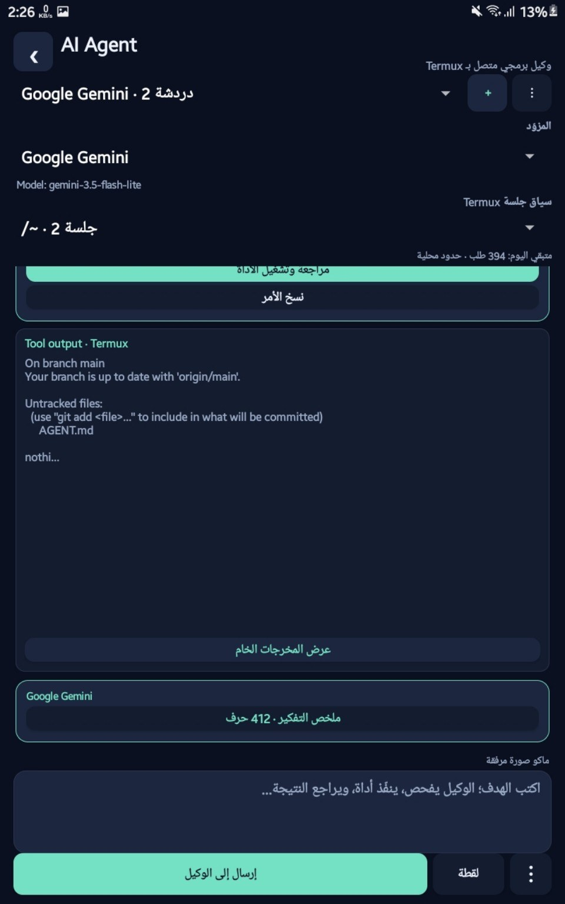
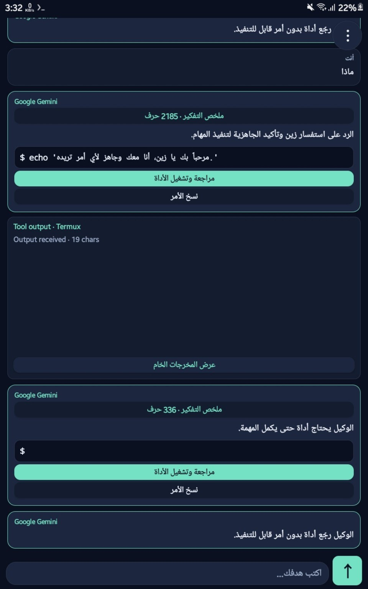

<div align="center">

<a href="https://github.com/its-zain-dev/TermuxFileManger/releases/latest">
  
</a>

<h1>Termux File Manager</h1>

<p><strong>Your files, code, terminal and AI agent. One native Android workspace.</strong></p>

<p>
  <a href="https://github.com/its-zain-dev/TermuxFileManger/releases/latest"><strong>Download Android APK</strong></a>
  &nbsp; | &nbsp;
  <a href="#install-on-android">Installation</a>
  &nbsp; | &nbsp;
  <a href="#screenshots">Screenshots</a>
  &nbsp; | &nbsp;
  <a href="#how-it-works">How it works</a>
  &nbsp; | &nbsp;
  <a href="docs/RELEASES.md">Release guide</a>
  &nbsp; | &nbsp;
  <a href="دليل-الاستخدام-عربي.md">الدليل العربي</a>
</p>

<p>
  
  
  
  
</p>

</div>

> **Termux File Manager (TFM)** is a native, open-source Android file manager built for people who work in Termux. Browse and edit files, run shell commands, manage programming tools and collaborate with an AI coding assistant, all from one app. No root required. **Version 0.5.0** introduces native ChatGPT tool calling and a searchable tools hub.

---

## Explore the workspace



*The vector panels above explain the workspace. Actual screenshots taken in the app are in the [screenshot gallery](#screenshots) below.*

<table>
  <tr>
    <td width="50%" valign="top">
      
      <h3>Files and folders</h3>
      Browse in list or grid view, follow breadcrumbs, search recursively, show hidden files, sort, pin favorites and revisit recent folders. Perform multi-select copy, move and delete operations with conflict handling and persistent history.
    </td>
    <td width="50%" valign="top">
      
      <h3>Code editor</h3>
      Edit UTF-8 text files up to 256 KiB with line numbers, search, undo/redo and saved drafts. Atomic writes preserve line endings and permissions; an external modification check prevents accidental overwrites.
    </td>
  </tr>
  <tr>
    <td valign="top">
      
      <h3>Termux terminal integration</h3>
      Choose working directories and named sessions, review commands before running, and inspect stdout, stderr and exit codes. Interactive terminal applications open in Termux instead of a simulated in-app PTY.
    </td>
    <td valign="top">
      
      <h3>AI coding agent</h3>
      Multi-conversation assistant with streamed responses, attached images, project context, web research, skill files and reviewed tool calls. Connect ChatGPT or your configured API provider; write operations require approval by default.
    </td>
  </tr>
  <tr>
    <td valign="top">
      
      <h3>Developer tools hub</h3>
      Search tools and manage Termux packages, Python/pip, npm, Cargo, Go, RubyGems, Composer and LuaRocks workflows. Run diagnostics, download files over HTTPS and work with archives.
    </td>
    <td valign="top">
      
      <h3>Designed for Android</h3>
      Kotlin, Jetpack Compose and Material 3 with responsive phone/tablet navigation, English/Arabic UI and light, dark and AMOLED themes. RTL layout preserves readable left-to-right paths and code.
    </td>
  </tr>
</table>

## Screenshots

These **are real screenshots saved from the Android app** on 28 October 2026. They capture an **earlier AI Agent interface**, not the current v0.5.0 Compose interface. They are included as historical in-app references until updated captures are available; individual screens and controls may differ in the latest APK.

<table>
  <tr>
    <td width="50%" align="center" valign="top">
      
      <br />
      <strong>AI Agent + terminal output</strong><br />
      <sub>Captured in the app; earlier build</sub>
    </td>
    <td width="50%" align="center" valign="top">
      
      <br />
      <strong>Command review + tool activity</strong><br />
      <sub>Captured in the app; earlier build</sub>
    </td>
  </tr>
</table>

**For the latest UI:** screenshots of the current Files, Editor, Terminal, Tools and Assistant screens can be added under `docs/screenshots/` without modifying the application. See [the screenshot contribution guide](docs/SCREENSHOTS.md) for capture and privacy rules. The illustrations on this page are not presented as real screenshots.

---

##  Download Termux File Manager

**Official signed APK:** [GitHub Releases — latest Android download](https://github.com/its-zain-dev/TermuxFileManger/releases/latest)

The published release includes the signed Android APK, its `.sha256` checksum, the build number and change notes. Use the **APK in the Assets section**, not the automatically generated GitHub *Source code (zip/tar.gz)* archives; source archives are not installable Android applications.

| Requirement | Details |
| :--- | :--- |
| App | Android 6.0+ (API 23+) |
| Termux backend | Current Termux releases need Android 7.0+ |
| Root access | Not required |
| CPU architecture | Use the signed APK attached to the release; check release notes for build specifics |
| Storage | Managed through Termux and Android permissions |
| AI models | Optional; account, API key, provider availability and usage limits vary |
| Updates | Must be signed with the **same permanent key** as your installed version |

### Install on Android



1. Open the [latest signed release](https://github.com/its-zain-dev/TermuxFileManger/releases/latest) on your phone or tablet. Expand **Assets** if the list is collapsed.
2. Download the file named like `Termux-File-Manager-v0.5.0-Android-signed.apk`. The name changes when a new version is published. Optionally download the matching `.apk.sha256` file.
3. Open the downloaded APK with Android's package installer. If Android blocks installation, allow **Install unknown apps** for the browser or file manager you are using. Revoke this permission afterward if desired.
4. Open Termux File Manager. If Termux is not installed, install it separately from an official source via [termux.dev](https://termux.dev/) and open Termux once.
5. In TFM, choose **Connect to Termux** and grant the Android permission to **Run commands in Termux environment**. Copy and run the setup command shown by TFM inside Termux; it configures external app access and required tools.
6. Restart Termux if the setup prompts you, return to TFM and select **Check connection**. File, terminal and developer operations can now use Termux with its own user permissions.
7. For Android shared storage, run `termux-setup-storage` in Termux and approve the system permission. Configure an AI provider separately if you want assistant features.

**Important:** TFM cannot browse another Android app's private files or bypass Termux/Android sandbox rules. The app does not ship a full Termux Linux environment or an embedded interactive terminal emulator.

### Verify your APK download

In a terminal with `sha256sum`, keep the APK and its matching checksum file in the same folder and run:

```sh
sha256sum -c Termux-File-Manager-v0.5.0-Android-signed.apk.sha256
```

Replace `v0.5.0` with your downloaded version. A valid match prints `OK`. A checksum detects a damaged or modified download; installation trust also depends on downloading from the official repository and verifying the Android signing identity.

### Updating an existing installation

Install a newer signed APK over your existing app **only when both use the same signing certificate**. The current release pipeline requires a permanent RSA-3072 signing identity in private GitHub Actions Secrets. Older unsigned APKs are not normally installable. Builds signed with a different key cannot update each other; back up application data before uninstalling a differently signed version. See [release and signing notes](docs/RELEASES.md).

---

## How it works



TFM is an **Android front end** connected to a separate **Termux execution environment**. File operations and shell commands run with Termux's accessible permissions. The Android app sends requests through the supported Termux command integration and records results for use in the workspace. The filesystem bridge uses a versioned JSON protocol, rather than relying on an embedded privileged shell.

**Safety boundary:** Read-only agent tools may run directly. Shell execution and file-changing actions are reviewable and require approval by default unless you explicitly enable automatic execution. Canceled or interrupted actions are not silently replayed after a restart; a command already dispatched to Termux may still finish on its own.

### The AI agent loop



The assistant can inspect projects, list and read files, search code, propose guarded updates, look up information on the web and ask to execute reviewed commands. **Native ChatGPT Responses function calls** are paired by `call_id` and stored with their results; other configured providers retain a compatible text-action protocol. The current model identifier shown in app information is the configured request model ID, not a verification of a provider's internal model weights.

<details>
<summary><strong>Supported AI services and authentication</strong></summary>

TFM supports configurable provider integrations for **OpenAI/ChatGPT, Google Gemini, Anthropic, OpenRouter, Groq, Mistral, Cohere, DeepSeek, xAI and Together AI**. You can select an editable model identifier and HTTPS endpoint with your own supported API credentials.

Where available in the app, **Continue with ChatGPT** uses a browser-based account sign-in/consent flow with PKCE. Authentication tokens are stored with Android Keystore-backed protection. ChatGPT plan access, availability, model catalogs, supported OAuth capabilities and usage limits depend on the signed-in account and service policies. ChatGPT subscription benefits are not interchangeable with separately billed API credits.

Provider requests transmit the conversation and any explicitly attached files/images to the selected remote endpoint. Review that provider's privacy and billing terms before connecting.

</details>

<details>
<summary><strong>Persistence and update compatibility</strong></summary>

TFM persists messages, named work sessions and command history in its app data. The Room database migration imports legacy v0.3 chat/session data transactionally. Preferences are kept in DataStore with compatibility for older settings, while existing AI keys remain protected by their historical Android Keystore identity. File operations are stored with completion or failure details so leaving the screen does not erase their history.

Existing Termux workspace files, including `~/.TFM-setting/Memory.md`, `instructions.md`, `config.json` and the older `system-propmet.md` spelling, retain their established names. Back up critical files and settings before major updates or uninstallations.

</details>

---

## Troubleshooting

| Problem | What to check |
| :--- | :--- |
| **APK won't install** | Confirm you downloaded `.apk` from **Assets**, allowed your file manager to install unknown apps, and have a supported Android version. |
| **"App not installed" during update** | The existing install may use a different signing certificate. Back up first; do not assume deleting the app preserves data. |
| **Termux not connected** | Open Termux once, grant TFM's command permission, run the setup command shown in TFM and restart Termux. |
| **Shared folders not accessible** | Run `termux-setup-storage` in Termux and approve Android storage permission. Android private app folders remain restricted. |
| **AI authentication or rate limit error** | Check selected provider, endpoint, API key or sign-in state, model availability, account quotas and provider error output. |
| **Terminal command still running** | Review the session's command status. Stopping the assistant does not guarantee cancellation of an already dispatched Termux process. |
| **Release isn't available** | Look at [GitHub Actions](https://github.com/its-zain-dev/TermuxFileManger/actions/workflows/android.yml); publication requires a successful signed release build. |

## Build from source

Requirements: **JDK 17**, Android SDK Platform **35**, Python 3 and the Gradle wrapper provided in this repository. The application uses Kotlin/Compose with minimum SDK 23 and target SDK 32 (retained for Termux command compatibility).

```sh
git clone https://github.com/its-zain-dev/TermuxFileManger.git
cd TermuxFileManger
python3 -m unittest discover -s tests -v
./gradlew --no-daemon testReleaseUnitTest lintRelease assembleRelease
```

A plain Gradle Release build is **unsigned** unless the four supported signing environment variables are configured. Maintainers can use `python3 scripts/release.py --build` to create/reuse their private local signing identity. For automated publishing, the dedicated workflow requires a **previously provisioned permanent key** in GitHub Actions Secrets and verifies the signed APK before attaching it to a release. **Never commit `.signing/`, keystores or passwords.**

For test devices or emulators:

```sh
./gradlew --no-daemon connectedDebugAndroidTest
```

The project uses the Gradle 8.9 wrapper, Room, DataStore, OkHttp, and a Termux JSON file bridge. The codebase is organized into `core`, `data`, `features`, `ui` and `assets/file_bridge.py`. Android test artifacts are for validation; downloadable releases contain **Release APKs only**.

## Documentation and project links

| Resource | Link |
| :--- | :--- |
| Latest signed APK and release notes | [GitHub Releases](https://github.com/its-zain-dev/TermuxFileManger/releases/latest) |
| All builds and previous releases | [Release history](https://github.com/its-zain-dev/TermuxFileManger/releases) |
| Installation and signing information | [Release guide](docs/RELEASES.md) |
| Feature history | [Changelog](CHANGELOG.md) |
| Arabic instructions | [دليل الاستخدام](دليل-الاستخدام-عربي.md) |
| Validation results | [Validation notes](docs/VALIDATION.md) |
| Capture new application screenshots | [Screenshot guide](docs/SCREENSHOTS.md) |
| Continuous integration | [GitHub Actions](https://github.com/its-zain-dev/TermuxFileManger/actions/workflows/android.yml) |

<div align="center">
  <a href="https://github.com/its-zain-dev/TermuxFileManger/releases/latest"><strong>Download Termux File Manager for Android</strong></a>
  <br />
  <sub>Native Android tooling for Termux · Open source · English and Arabic</sub>
</div>
